<h1 align="center">Akarsh Jaiswal</h1>

Full-time debugger, part-time developer.

My latest public project is [MicWright](https://github.com/Ryuu-x/MicWright), a Windows app that cleans up your microphone as you talk: it removes background noise and evens out your volume, then passes the result to Discord, OBS, games or anything else listening. It runs entirely on your PC, and no audio goes online.

### Projects

**[MicWright](https://github.com/Ryuu-x/MicWright)** is real-time voice enhancement for Windows, with noise removal, auto level, EQ, a soundboard and A/B comparison against the raw mic. Written mainly in Rust.

**[TicTacToe-Multiplayer](https://github.com/Ryuu-x/TicTacToe-Multiplayer)** is real-time Tic Tac Toe over WebSockets, using React, Node.js and Socket.IO. The first two people in are assigned X and O, and anyone after that spectates.

**[File-Sharing-App](https://github.com/Ryuu-x/File-Sharing-App)** is a file sharing web app, [live on Vercel](https://file-sharing-app-taupe.vercel.app).

**[RealTime-Chat-App](https://github.com/Ryuu-x/RealTime-Chat-App)** is a real-time chat app in JavaScript.

### Contributions

<picture>
  <source media="(prefers-color-scheme: dark)" srcset="assets/contributions-dark.svg">
  <source media="(prefers-color-scheme: light)" srcset="assets/contributions-light.svg">
  
</picture>

### Recently

<!-- recent:start -->
| Repository | Language | Last push | Latest release |
| :-- | :-- | :-- | :-- |
| [MicWright](https://github.com/Ryuu-x/MicWright) | Rust | 9 Nov 2026 | [v1.0.0](https://github.com/Ryuu-x/MicWright/releases/tag/v1.0.0) |
| [TicTacToe-Multiplayer](https://github.com/Ryuu-x/TicTacToe-Multiplayer) | TypeScript | 31 Jan 2026 | None |
| [File-Sharing-App](https://github.com/Ryuu-x/File-Sharing-App) | JavaScript | 12 Jan 2026 | None |
| [RealTime-Chat-App](https://github.com/Ryuu-x/RealTime-Chat-App) | JavaScript | 8 Oct 2025 | None |
| [Basic-Spring-CRUD-app](https://github.com/Ryuu-x/Basic-Spring-CRUD-app) | Java | 7 Sep 2025 | None |

- 8 Nov 2026: Released [v1.0.0](https://github.com/Ryuu-x/MicWright/releases/tag/v1.0.0) of [MicWright](https://github.com/Ryuu-x/MicWright)
- 6 Nov 2026: Made [MicWright](https://github.com/Ryuu-x/MicWright) public
<!-- recent:end -->

Elsewhere: [LinkedIn](https://www.linkedin.com/in/akarshja)

The graph and the Recently section are rebuilt daily from GitHub data by [a small script](https://github.com/Ryuu-x/Ryuu-x/blob/main/scripts/update_readme.py).
